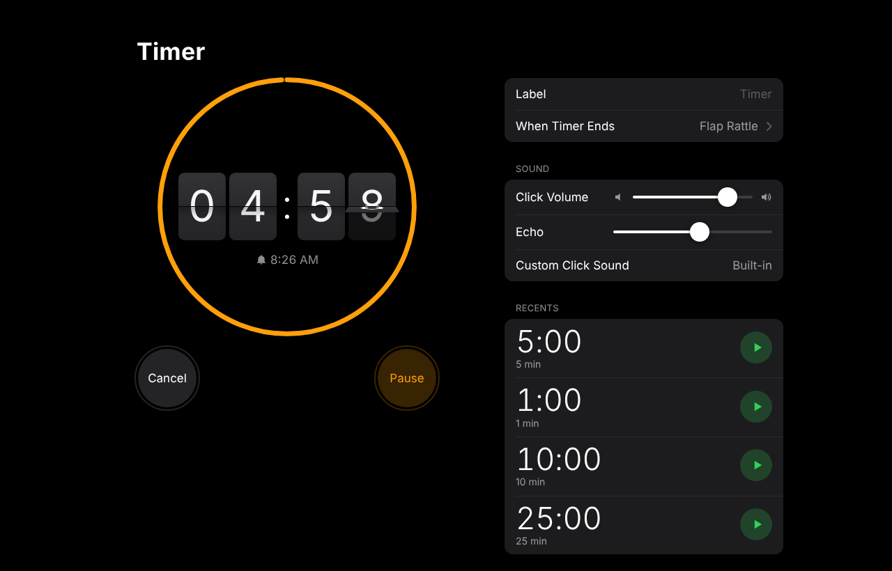

# Flip Timer

A phone-style timer where the countdown runs on split-flap cards. You set it with scroll wheels; when it starts, the cards flip down second by second with a mechanical click, inside a progress ring.



## Run it

No build step and no dependencies. Open `index.html` in a browser, or serve the folder:

```sh
python3 -m http.server 8000
# then open http://localhost:8000
```

## What it does

- **Scroll wheels** for hours, minutes and seconds (up to 23:59:59). Each notch clicks as it rolls past.
- **Split-flap countdown.** When you press Start, every card spins up from zero to the set time, then flips once per second. Each card turns forward only, like the real hardware.
- **Ring and end time.** An orange ring drains as time runs out, and the time it will finish is shown underneath.
- **Round Cancel / Start / Pause / Resume buttons.**
- **When Timer Ends:** Flap Rattle (the whole board clatters every few seconds until you tap Stop), Single Rattle, or Silent. Android phones also vibrate.
- **Sound:** a click volume slider, an echo slider, and an option to use your own click sound.
- **Recents:** tap ▶ to run one again, or tap the row to load it onto the wheels.
- **Wallpaper:** 6 built-in backgrounds or your own photo, with dim and blur.
- **Label** shown on the ring and the done alert.
- Settings and a running timer are kept if you close and reopen it. The screen stays awake while the timer runs.

## Install it on your phone

It's an installable web app (PWA): once it's on your home screen it opens full screen with its own icon and works offline.

1. Host it with GitHub Pages: in the repo, **Settings → Pages → Build and deployment → Source: Deploy from a branch**, branch `main`, folder `/ (root)`, and save. After a minute it's live at `https://<your-username>.github.io/Timer/`.
2. Open that link on your phone:
   - **iPhone (Safari):** Share button → **Add to Home Screen**.
   - **Android (Chrome):** ⋮ menu → **Install app**.

Notes:
- On iPhone, sound follows the silent switch. Newer iOS versions show a setting to play clicks even on silent.
- Phones pause web apps in the background, so it can't alert you while the app is closed. When you come back, it shows the correct time left.
- After you push changes, bump `VERSION` in `sw.js` so installed copies pick them up.

## Keyboard

| Key | Action |
| --- | --- |
| `Space` | Start / pause / resume |
| `Esc` or `R` | Cancel |
